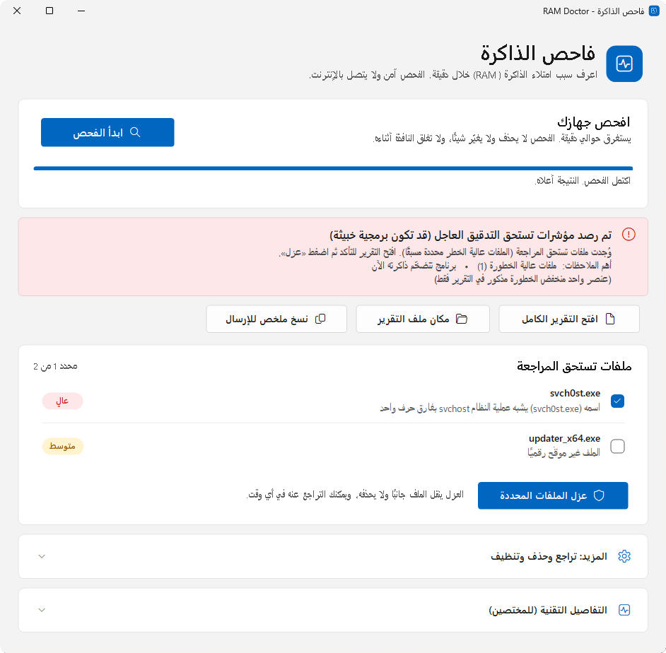
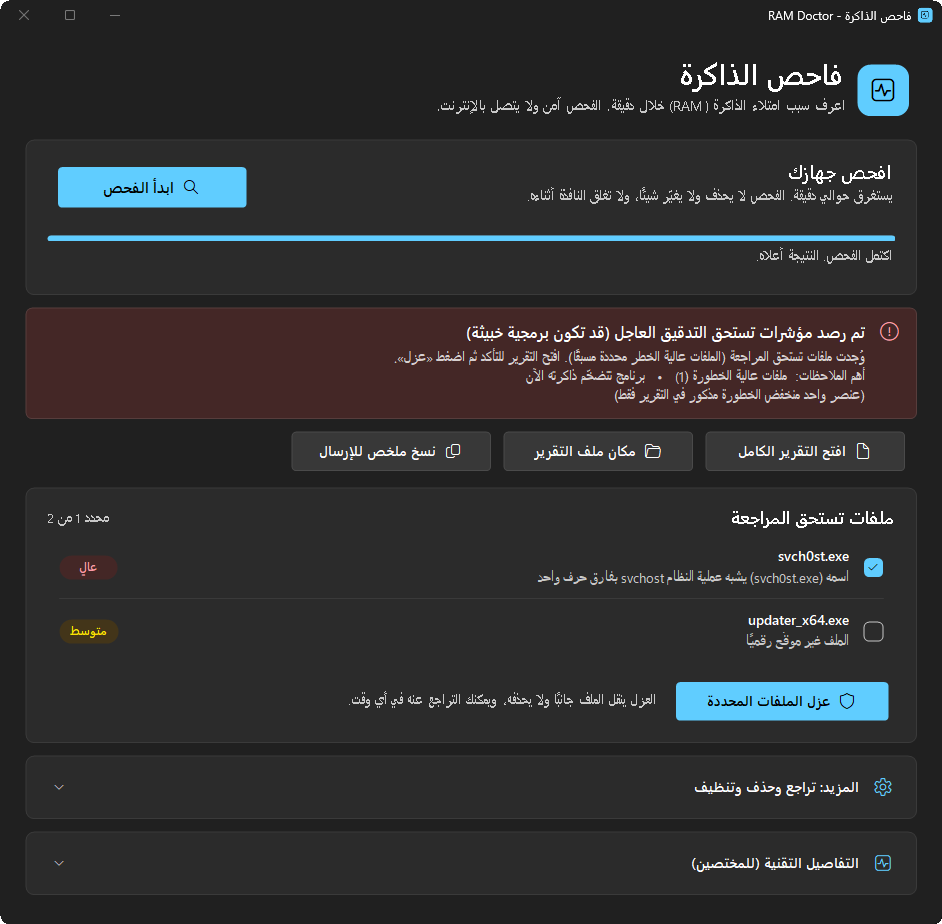
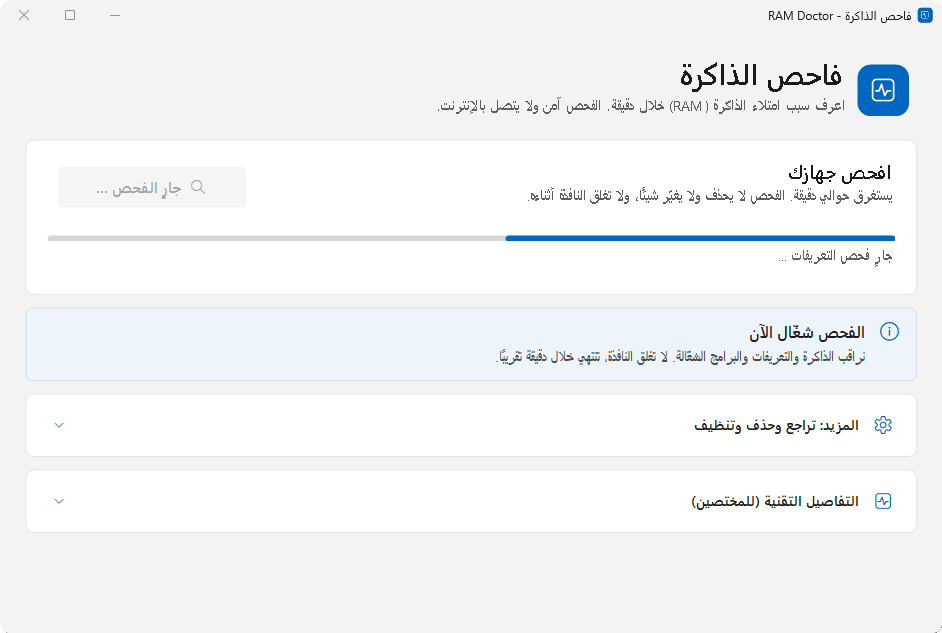
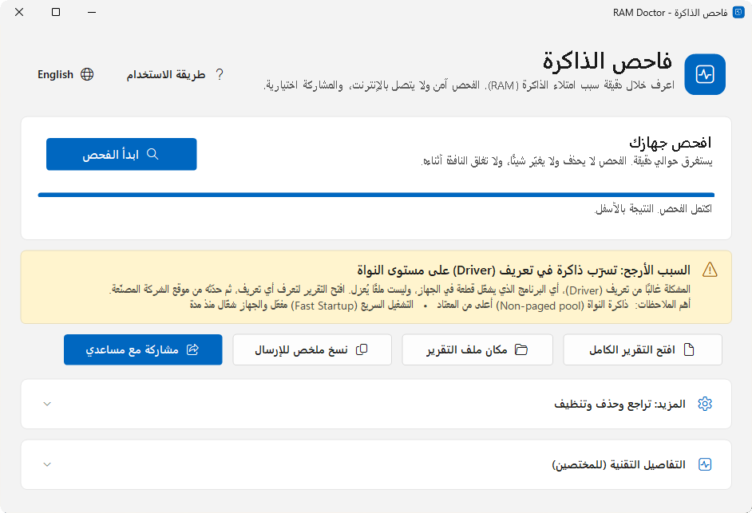
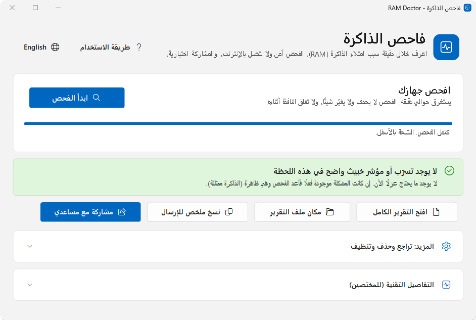
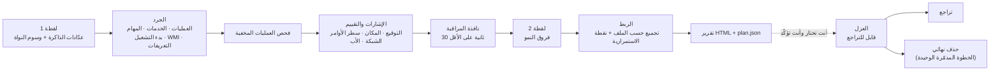
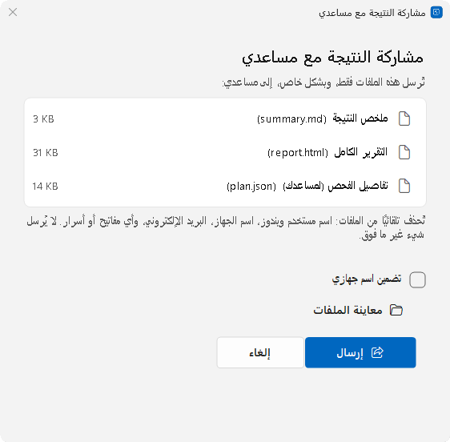
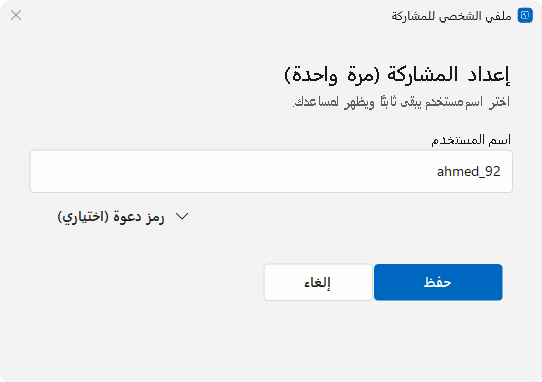

<div dir="rtl" lang="ar">

<div align="center">

# RAM Doctor — فاحص الذاكرة

**اعرف لماذا ذاكرة جهازك (RAM) ممتلئة بينما مدير المهام لا يُظهر شيئًا.**

فحص للقراءة فقط لويندوز 11 و10: تسرّب ذاكرة النواة، ذاكرة غير منسوبة لأي برنامج،
عمليات مخفية أو مشبوهة، مع تنظيف قابل للتراجع.

[](https://github.com/iiKurro/ram-doctor/actions/workflows/ci.yml)
[](https://github.com/iiKurro/ram-doctor/releases/latest)
[](LICENSE)
[](#أسئلة-شائعة)
[](docs/architecture.md)
[](docs/privacy-and-safety.md)

[**تنزيل**](https://github.com/iiKurro/ram-doctor/releases/latest/download/RAM-Doctor.bat) &nbsp;·&nbsp;
[الموقع](https://iikurro.github.io/ram-doctor/) &nbsp;·&nbsp;
[التوثيق (بالإنجليزية)](docs/) &nbsp;·&nbsp;
[English](README.md) &nbsp;·&nbsp;
[أبلغ عن إنذار كاذب](https://github.com/iiKurro/ram-doctor/issues/new?template=false_positive.yml)

[English](README.md) · **العربية**

<table>
  <tr>
    <td align="center"></td>
    <td align="center"></td>
  </tr>
</table>

</div>

## لماذا RAM Doctor

جهاز فيه 16 GB من الذاكرة «مستخدمة»، وسطح المكتب فارغ، ومجموع العمليات في مدير
المهام لا يساوي إلا جزءًا صغيرًا من ذلك. هذا يحدث فعلًا، وأسبابه المعتادة لا
يعرضها مدير المهام:

* **تسرّب في ذاكرة النواة.** تعريف (Driver) للشبكة أو الشاشة أو التخزين أو VPN أو
  برنامج الحماية يحجز ذاكرة من المجمّع غير المتصفّح (non-paged pool) أو المتصفّح
  (paged pool) ولا يحرّرها. هذه الذاكرة **لا تتبع أي عملية**، فلا تظهر في قائمة
  البرامج.
* **ذاكرة خارج كل العمليات.** صفحات محجوزة من تعريفات، AWE، أقراص RAM،
  مناطق محجوزة للعتاد.
* **شيء متخفٍّ.** برنامج تعدين أو برمجية خبيثة تنتحل اسم عملية نظام، أو تعمل من
  مجلد `Temp`، أو تختفي من قائمة العمليات.
* **برنامج عادي ذاكرته تكبر بصمت**، أو «التشغيل السريع» (Fast Startup) الذي يُبقي
  نواة متسرّبة حيّة بعد «إيقاف التشغيل».

يقرأ RAM Doctor أدلة كل هذه الحالات خلال دقيقة تقريبًا، ويخبرك بلغة واضحة أيّها
تواجه، ثم يتيح لك التعامل مع الملفات المشبوهة **بأمان وبشكل قابل للتراجع**.

هو لا يحلّ محل RAMMap ولا PoolMon ولا مضاد الفيروسات؛ بل يربط ما تعطيك إياه هذه
الأدوات ويدلّك على الأداة التالية عند الحاجة.

<details>
<summary><b>لقطات إضافية</b></summary>

<table>
  <tr>
    <td align="center"><br><sub>الفحص قيد التنفيذ</sub></td>
    <td align="center"><br><sub>نتيجة: تسرّب في ذاكرة النواة</sub></td>
    <td align="center"><br><sub>نتيجة سليمة</sub></td>
  </tr>
</table>

</details>

## الميزات

* **أشعة سينية للذاكرة:** الذاكرة الخاصة مقابل المشتركة، المجمّع المتصفّح وغير
  المتصفّح، قوائم Modified وStandby، و**الباقي غير المنسوب**، مع قياسين يوضحان ما
  يكبر **الآن**.
* **جدول وسوم المجمّع (Pool tags)** (نفس بيانات PoolMon) مع ترجيح التعريفات
  التي تحوي أكبر الوسوم وأسرعها نموًا.
* **فحص العمليات المخفية:** يسأل النواة عن كل PID ويقارنه بالقوائم العادية، ويفرّق
  بين العملية المخفية الحقيقية وبين عمليات «zombie» غير الضارة.
* **كشف مشبوهات مع تفسير:** التوقيع، المكان، انتحال أسماء النظام، أنماط سطر
  الأوامر، مؤشرات التعدين، الأب غير الطبيعي، اتصالات منافذ التعدين، النمو. كل
  نتيجة تذكر **لماذا**، مع درجة منخفضة / متوسطة / عالية
  ([التفاصيل](docs/how-detection-works.md)).
* **جرد التشغيل التلقائي:** الخدمات (بما فيها ملفات `svchost`)، المهام المجدولة،
  مفاتيح Run لكل المستخدمين، مجلدات بدء التشغيل، اشتراكات WMI الدائمة، التعريفات
  الشغّالة، وشذوذات Winlogon / IFEO / AppInit.
* **عزل قابل للتراجع:** إيقاف وتعطيل ونقل الملف جانبًا؛ و**«تراجع»** يُرجع كل شيء.
  الحذف النهائي (**Purge**) خطوة منفصلة.
* **نافذة بطابع ويندوز 11** تتبع الوضع الفاتح/الداكن، وتقرير HTML **بالعربية (RTL) أو بالإنجليزية (LTR)**
  (انظر [اللغات](#اللغات)).
* **سهلة القراءة والاستخدام للجميع:** واضحة بأي تكبير للشاشة (125-200٪، وحتى عند نقلها بين الشاشات)، وتعمل مع
  قارئ الشاشة (لكل زر وخانة اختيار وبطاقة جولة اسم يُقرأ)، ومعها جولة تعريفية سريعة في النافذة.
* **ملف واحد بلا تثبيت:** `RAM-Doctor.bat` نص عادي مقروء. لا يبقى شيء بعد الإغلاق
  سوى التقرير الصغير الذي طلبته.
* **سهولة إرسال التقرير للمساعد:** فتح مكان الملف، أو نسخ ملخص مموَّه، أو زر
  **المشاركة** الاختياري.
* **خفيف على الجهاز المتعب:** الفحص يستهلك في ذروته نحو 110 MB من الذاكرة (قياس على
  جهاز عادي)، ويعمل بأولوية معالج وقرص وذاكرة أقل من الطبيعية، ويستغرق نحو دقيقة.
* **الخصوصية أولًا:** الفحص لا يستخدم الشبكة إطلاقًا ولا توجد أي بيانات تتبّع.

## البدء السريع

> **أول مرة؟** اقرأ [طريقة الاستخدام بالصور](https://iikurro.github.io/ram-doctor/guide.html)، أو اضغط زر
> **طريقة الاستخدام** أعلى النافذة لتظهر جولة سريعة (دقيقة واحدة) تضيء كل جزء وتشرحه. الجولة لا تفحص
> ولا تغيّر شيئًا، وتعرضها النافذة تلقائيًا في أول استخدام.

1. **نزّل** [`RAM-Doctor.bat`](https://github.com/iiKurro/ram-doctor/releases/latest/download/RAM-Doctor.bat)
   من [آخر إصدار](https://github.com/iiKurro/ram-doctor/releases/latest).
   وللتحقق (اختياري): `Get-FileHash .\RAM-Doctor.bat -Algorithm SHA256` وقارن
   الناتج مع `SHA256SUMS.txt`.
2. **انقر عليه مرتين.** إن ظهر تحذير SmartScreen فاضغط *More info* ثم *Run anyway*
   (الملف غير موقّع رقميًا، لكنه نص عادي يمكنك قراءته قبل التشغيل). وافق على
   نافذة **UAC**: صلاحيات المدير تعطي رؤية كاملة.
3. اضغط **ابدأ الفحص** وانتظر دقيقة تقريبًا. شغّله **والمشكلة ظاهرة** (الذاكرة
   ممتلئة)؛ الفحص يرى لحظة تشغيله فقط.
4. **اقرأ النتيجة.** العنوان يخبرك بالسبب المرجّح، و«افتح التقرير الكامل» يشرح الأدلة.
5. *فقط إن أظهر التقرير ملفات مشبوهة:* حدّدها واضغط **عزل**. أعد تشغيل الجهاز ثم
   افحص مجددًا للتأكد أن الذاكرة رجعت طبيعية.
6. *إن كان أحد يساعدك،* أرسل له النتيجة: [إرسال التقرير للمساعد](#إرسال-التقرير-للمساعد).

> استخدم **إعادة التشغيل (Restart)** وليس «إيقاف التشغيل (Shut down)»: مع التشغيل
> السريع لا يُصفَّر النواة عند الإيقاف، فيبقى التسرّب.

### اللغات

النافذة والتقرير وكل ما يكتبه الفحص متوفرة **بالعربية (من اليمين إلى اليسار)** و**بالإنجليزية
(من اليسار إلى اليمين)**. يفتح RAM Doctor بالعربية إذا كانت لغة عرض ويندوز عربية،
وبالإنجليزية فيما عدا ذلك؛ وزر **الكرة الأرضية** في رأس النافذة يبدّل النافذة المفتوحة فورًا
(مع اتجاه التخطيط) دون إعادة تشغيل ودون حفظ أي شيء. يكتب الفحص تقريره باللغة المفعّلة وقت
الضغط على **ابدأ الفحص**. من سطر الأوامر استخدم `-Lang ar|en`. كل النصوص في ملف واحد:
[`src/lib/Strings.ps1`](src/lib/Strings.ps1).

## كيف يعمل



النافذة تشغّل سكربتين فقط: **الفحص** (لا يغيّر النظام أبدًا) و**الإجراءات** (الكود
الوحيد الذي يغيّر شيئًا، وفقط على العناصر التي تختارها). التفاصيل في
[docs/architecture.md](docs/architecture.md).

## ماذا يفحص

| المجال | ما الذي يُفحص |
| --- | --- |
| الذاكرة | الإجمالي / المستخدم / المتاح، الذاكرة الخاصة والمشتركة، المجمّع المتصفّح وغير المتصفّح، Modified وStandby، الـ Commit مقابل الحد، المحجوز للعتاد، الباقي غير المنسوب، النمو خلال نافذة المراقبة |
| مجمّع النواة | جدول الوسوم، أكبر الوسوم، الأسرع نموًا، التعريفات المرشّحة لكل وسم |
| العمليات | المسار (حتى للعمليات المحمية)، التوقيع، المكان، سطر الأوامر، الأب، وقت البدء، المقابض (Handles)، النمو، اتصالات الشبكة |
| العمليات المخفية | فحص PID مباشر عبر النواة مقابل قوائم النظام؛ حيّة أم zombie |
| الاستمرارية | الخدمات، المهام المجدولة، Run/RunOnce (كل مستخدمي الجهاز)، مجلدات بدء التشغيل، مستهلكو WMI الدائمون، Winlogon / IFEO / AppInit |
| التعريفات | التعريفات الشغّالة، غير التابعة لمايكروسوفت مرتبة بالأحدث، التوقيع |
| الأدلة | حالة Defender واكتشافاته، أحداث Resource-Exhaustion، التشغيل السريع ومدة التشغيل |

## ماذا يحفظ على جهازك

| أين | ماذا | متى |
| --- | --- | --- |
| `C:\ProgramData\RAM-Doctor-run\<عشوائي>\` | السكربتات المفكوكة من الملف الواحد (~625 KB) داخل مجلد لا يكتب فيه إلا المدير والنظام | أثناء فتح النافذة؛ تُحذف عند الإغلاق |
| `Desktop\RAM-Doctor-Reports\` | `RAMDoctor-<الجهاز>-<الوقت>.html` و`Plan-<الجهاز>-<الوقت>.json` (~45 KB لكل فحص) | كل فحص؛ تُحفظ **آخر 3** فحوصات فقط |
| `C:\ProgramData\RAM-Doctor\` | الملفات المعزولة، `manifest.json`، `actions-<الوقت>.log` | فقط إن استخدمت العزل |
| نقطة استعادة النظام | «RAM-Doctor before quarantine» | قبل العزل، إن كانت حماية النظام مفعّلة |
| `%APPDATA%\RAM-Doctor\profile.json` | الاسم المعروض، معرّف عشوائي، وربما رمز محمي بـ DPAPI (< 1 KB) | **فقط إن استخدمت زر المشاركة**؛ ويمكن للتطبيق حذفه |

لا تغيير في السجل (Registry)، ولا خدمات، ولا مهام مجدولة، ولا عناصر بدء تشغيل.
الفحص **لا يتصل بالشبكة**. التفاصيل: [docs/privacy-and-safety.md](docs/privacy-and-safety.md).

## إرسال التقرير للمساعد

إن كان صديق أو فنّي يساعدك فعندك ثلاثة خيارات، من الأكثر يدوية إلى الأكثر راحة.
**لا تنشر التقارير في Issues عامة.**

| الخيار | ماذا يفعل |
| --- | --- |
| **مكان ملف التقرير** | يفتح مستكشف الملفات والتقرير محدَّد، جاهزًا للإرفاق بالبريد أو المحادثة. الملف *غير مموَّه*: أرسله لمن تثق به فقط. |
| **نسخ ملخص للإرسال** | ينسخ ملخصًا نصيًا قصيرًا **مموَّهًا** للصقه في المحادثة. اقرأه قبل الإرسال. |
| **مشاركة مع مساعدي** (اختياري) | بضغطة واحدة: يرفع حزمة **مموَّهة** إلى مستودع مساعدك **الخاص**. |

**الفحص لا يستخدم الشبكة ولا توجد بيانات تتبّع. الميزة الوحيدة التي تستخدم الشبكة هي
زر المشاركة، ولا يفعل شيئًا حتى تضغطه وتؤكّد؛ ثم يرفع حزمة مموَّهة
(`summary.md` و`report.html` و`plan.json`) إلى المستودع *الخاص* للمساعد.**
في أول استخدام تختار اسم مستخدم دائمًا (لا حاجة إلى رمز دعوة). يُحذف اسم مستخدم
ويندوز، واسم الجهاز (إلا إن علّمت الخيار)، والبريد الإلكتروني، والأسرار الموجودة في
أسطر الأوامر. الزر **مخفي** في الإصدارات التي لم يُضبط فيها عنوان وسيط. البرنامج لا
يحمل أي مفتاح: وسيط صغير (Cloudflare Worker، في [`server/`](server/README.md)) يتولى
الرفع، مع حدود معدّل، وقائمة بيضاء من ثلاثة ملفات فقط، وسقف 2 MB، وتنظيف التقارير
لتبقى خاملة، وبلا مسار لقراءة المحفوظات، ومفتاح إيقاف طارئ. كيف يعمل، وكيف ينشر
المساعد وسيطه الخاص: [docs/sharing.md](docs/sharing.md) · وجهة نظر الخصوصية:
[docs/privacy-and-safety.md](docs/privacy-and-safety.md#the-optional-share-button).

<table>
  <tr>
    <td align="center"><br><sub>مشاركة مع مساعدي</sub></td>
    <td align="center"><br><sub>ملفك الشخصي، مع زر حذف</sub></td>
  </tr>
</table>

## نموذج الأمان

* **الفحص للقراءة فقط.** لا يستطيع تغيير نظامك.
* **التغييرات صريحة.** العزل يعمل فقط على ما تحدّده وتؤكّده.
* **قابل للتراجع افتراضيًا.** الملفات تُنقل إلى مجلد عزل (بامتداد `.quar`)، والخدمات
  والمهام **تُعطَّل** فقط، وقيم بدء التشغيل تُحفظ نسخة منها. **«تراجع»** يُلغي كل
  ذلك. **الحذف النهائي (Purge)** هو الخطوة المدمّرة الوحيدة ويطلب تأكيدًا منفصلًا.
* **ويندوز لا يُمَسّ أبدًا.** أي شيء داخل `%WINDIR%` وأي ملف بتوقيع مايكروسوفت
  صحيح يُرفض. وتعريفات الإقلاع/النظام تُرفض.
* **إعادة تحقق في اللحظة الأخيرة.** فحص اسم الجهاز، وإعادة حساب SHA-256، وفحص
  PID مع وقت البدء قبل إيقاف أي عملية.
* **شبكة أمان.** يُطلب أولًا إنشاء نقطة استعادة للنظام.
* **حدود صريحة.** ملف الخطة مدخل محلي موثوق؛ والأداة ليست مضاد فيروسات.
  انظر [docs/privacy-and-safety.md](docs/privacy-and-safety.md#known-limitations).

## قراءة النتائج

| العنوان | معناه | ماذا تفعل |
| --- | --- | --- |
| *السبب الأرجح: تسرّب ذاكرة في تعريف على مستوى النواة* | المجمّع المتصفّح أو غير المتصفّح أعلى بكثير من الطبيعي (عدة GB مثلًا). لا عملية تملكه. | افتح التقرير وانظر **جدول الوسوم** والتعريف المرشّح، حدّث التعريف أو أزله (أو أزل البرنامج الذي ثبّته)، أعد التشغيل، وافحص مجددًا. |
| *جزء كبير من الذاكرة غير منسوب لأي عملية* | ذاكرة خارج كل Working Set: محجوزة من تعريف، AWE، قرص RAM، عملية مخفية. | استخدم تبويب *Use Counts* في RAMMap لمعرفة النوع، وراجع قسم العمليات المخفية. |
| *مؤشرات تستحق التدقيق العاجل (قد تكون برمجية خبيثة)* | ملف أو أكثر بخطورة **عالية**، أو عملية حيّة مخفية. | افحص SHA-256 في VirusTotal، شغّل فحصًا دون اتصال (Defender Offline)، ثم اعزل إن تأكّدت. |
| *ملاحظات متوسطة الخطورة* | شيء غير معتاد لكن غير حاسم (قرب حد الـ Commit، التشغيل السريع، برنامج يكبر). | اقرأ الملاحظات؛ غالبًا يكفي إعادة تشغيل أو تحديث. |
| *لا يوجد تسرّب أو مؤشر خبيث واضح في هذه اللحظة* | لم يتجاوز شيء الحدود الآن. | افحص مجددًا **والذاكرة ممتلئة**. |

**مستويات الخطورة** تأتي من درجة: عالية >= 8، متوسطة 5-7، منخفضة 3-4 (المنخفضة
تُذكر في التقرير ولا تُعرض للعزل). هي **مؤشرات وليست أحكامًا**: أداة صغيرة غير
موقّعة في `AppData` تكون «منخفضة» بالتصميم. انظر
[docs/how-detection-works.md](docs/how-detection-works.md).

## سطر الأوامر (متقدم)

```powershell
# فحص فقط؛ يكتب التقرير والخطة في Desktop\RAM-Doctor-Reports
powershell -NoProfile -ExecutionPolicy Bypass -File src\RAM-Doctor.ps1 -NoOpen

# إجراءات على آخر خطة (بصلاحيات المدير)
powershell -NoProfile -ExecutionPolicy Bypass -File src\RAM-Doctor-Actions.ps1 -Mode Quarantine -Select "1,3"
powershell -NoProfile -ExecutionPolicy Bypass -File src\RAM-Doctor-Actions.ps1 -Mode Restore
powershell -NoProfile -ExecutionPolicy Bypass -File src\RAM-Doctor-Actions.ps1 -Mode List
```

| السكربت | المعاملات |
| --- | --- |
| `RAM-Doctor.ps1` | `-SampleSeconds 30` نافذة المراقبة · `-OutDir` · `-NoOpen` · `-KeepRawJson` · `-ThresholdScale 1.0` (أقل من 1 = أكثر حساسية) |
| `RAM-Doctor-Actions.ps1` | `-Mode Quarantine\|Restore\|Purge\|List` · `-Plan` · `-Select "1,3"` · `-IncludeLow` · `-Yes` · `-NoRestorePoint` · `-Batch` · `-OlderThanDays` · `-StoreDir` |

## أسئلة شائعة

<details>
<summary><b>هل يرفع بياناتي؟</b></summary>

**الفحص لا يستخدم الشبكة ولا توجد بيانات تتبّع.** الميزة الوحيدة التي تستخدم
الشبكة هي زر **المشاركة مع مساعدي** الاختياري. لا يفعل شيئًا حتى تضغطه وتؤكّد،
ثم يرفع حزمة مموَّهة (`summary.md` و`report.html` و`plan.json`) إلى المستودع
الخاص بمساعدك عبر وسيط؛ والبرنامج نفسه لا يحمل أي مفتاح. الزر مخفي في الإصدارات
التي لا تحوي عنوان وسيط، ويمكنك دائمًا إرسال التقرير يدويًا. انظر
[docs/privacy-and-safety.md](docs/privacy-and-safety.md).
</details>

<details>
<summary><b>مضاد الفيروسات يحذّر منه. هل هو فيروس؟</b></summary>

هو أداة PowerShell/batch غير موقّعة تستعرض العمليات وتقرأ إحصاءات النواة وتستطيع
إيقاف عمليات ونقل ملفات؛ وبعض المنتجات تنبّه لهذا السلوك. الإصدار نص عادي بلا
تشفير ولا base64 ولا `Invoke-Expression` ولا نافذة مخفية، فتقرأ بنفسك ما يفعله
بالضبط. تحقق من SHA-256 مقابل `SHA256SUMS.txt`، وبلّغ الشركة عن الإنذار الكاذب.
انظر [docs/troubleshooting.md](docs/troubleshooting.md#antivirus-flags-or-deletes-ram-doctorbat).
</details>

<details>
<summary><b>لماذا غير موقّع رقميًا؟</b></summary>

شهادات التوقيع مدفوعة، وهذا مشروع مجاني يطوّره مطوّر واحد. التوقيع ضمن خارطة الطريق؛
وإلى ذلك الحين تحقق من المجموع الاختباري (checksum).
</details>

<details>
<summary><b>لماذا يحتاج صلاحيات المدير؟</b></summary>

للرؤية الكاملة (مسارات العمليات المحمية، عناصر بدء التشغيل لبقية المستخدمين)
وللإجراءات (تعطيل الخدمات، إنشاء نقطة استعادة، الكتابة في مخزن العزل). الفحص وحده
يعمل بدونها لكن بتغطية أقل.
</details>

<details>
<summary><b>هل يغني عن مضاد الفيروسات؟</b></summary>

لا. هو يشرح مشاكل الذاكرة وينبّه على المشبوهات بقواعد استدلالية. استخدمه بجانب
مضاد الفيروسات، واستعمل فاحصًا دون اتصال إن ظهرت عملية حيّة مخفية.
</details>

<details>
<summary><b>برنامج سليم صُنّف مشبوهًا. ماذا أفعل؟</b></summary>

الدرجات مؤشرات استدلالية. افتح
[بلاغ إنذار كاذب](https://github.com/iiKurro/ram-doctor/issues/new?template=false_positive.yml)
بالتفاصيل بعد إخفاء بياناتك؛ ضبط الأوزان من بلاغات حقيقية هو أنفع مساهمة.
</details>

<details>
<summary><b>هل يجد كل الأسباب؟</b></summary>

لا. انظر [ما لا يكتشفه](docs/how-detection-works.md#what-is-not-detected):
حدود اللقطة الواحدة، وروتكيتات مستوى النواة، والبرمجيات الخبيثة الموقّعة، والكود
المحقون، ودقة نسبة الوسم إلى التعريف.
</details>

<details>
<summary><b>ما إصدارات ويندوز المدعومة؟</b></summary>

طُوّر واختُبر على ويندوز 11. ويندوز 10 (22H2) متوقع أن يعمل لكنه أقل اختبارًا،
وتأثيرات ويندوز 11 البصرية فقط لا تظهر فيه. يحتاج Windows PowerShell 5.1 وهو
موجود في الاثنين. النافذة والتقرير متوفران **بالعربية والإنجليزية** (انظر [اللغات](#اللغات)).
</details>

<details>
<summary><b>هل يعمل دون إنترنت؟</b></summary>

نعم. الفحص والتقرير والإجراءات لا تحتاج إنترنت. زر المشاركة الاختياري وحده يحتاجه.
</details>

## البناء من المصدر

```powershell
git clone https://github.com/iiKurro/ram-doctor.git
cd ram-doctor
powershell -NoProfile -File build\Build-SingleFile.ps1     # -> dist\RAM-Doctor.bat
```

للتشغيل مباشرة من المصدر (من نافذة بصلاحيات المدير):
`powershell -NoProfile -ExecutionPolicy Bypass -STA -File src\RAM-Doctor-GUI.ps1`.
كيف يُبنى إصدار الملف الواحد ولماذا هو نص عادي:
[docs/architecture.md](docs/architecture.md#single-file-packer).

## هيكل المشروع

```
ram-doctor/
├─ src/
│  ├─ RAM-Doctor-GUI.ps1        النافذة بطابع ويندوز 11 (تشغّل السكربتين أدناه)
│  ├─ RAM-Doctor.ps1            الفحص للقراءة فقط -> التقرير + plan.json
│  ├─ RAM-Doctor-Actions.ps1    عزل / تراجع / حذف نهائي / عرض
│  └─ lib/
│     ├─ Native.cs              مساعدات P/Invoke للقراءة فقط (وسوم المجمّع، فحص PID ...)
│     ├─ Fluent.cs              عناصر WinForms بطابع ويندوز 11 (ومنها طبقة الجولة)
│     ├─ Tour.ps1               الجولة التعريفية داخل النافذة
│     └─ Report.ps1             منشئ تقرير HTML
├─ server/                      الوسيط (Cloudflare Worker) خلف زر المشاركة
├─ build/Build-SingleFile.ps1   يحزم src/ في dist/RAM-Doctor.bat
├─ tests/                       فحوصات آلية (يشغّلها CI)
├─ docs/                        التوثيق وموقع المشروع
└─ .github/                     CI وسير الإصدار ونماذج البلاغات
```

## خارطة الطريق

أفكار وليست وعودًا:

* لغات واجهة إضافية (جدول النصوص الموحَّد يجعل إضافة لغة عمل ترجمة فقط).
* توقيع الإصدارات رقميًا؛ وحزمة `winget`.
* تفصيل أنواع الذاكرة على طريقة RAMMap (محجوزة من تعريف، AWE، ملفات معيّنة).
* تتبّع تخصيصات المجمّع عبر ETW لتسمية مكدّس الاستدعاء المتسبّب بالتسرّب.
* مواضع استمرارية إضافية (Active Setup وBHO وprint monitors ومزوّدو LSA)
  وفحص الوحدات والحقن.
* وضع دون اتصال / WinPE.
* مخططات JSON موثّقة ومرقّمة للخطة والتقرير.

## المساهمة

البلاغات عن الأخطاء و**البلاغات عن الإنذارات الكاذبة** مرحَّب بها. المساهمة
بالكود غير مقبولة: المشروع جميع الحقوق محفوظة. اقرأ [CONTRIBUTING.md](CONTRIBUTING.md)
و[مدونة السلوك](CODE_OF_CONDUCT.md).
وجدت ثغرة أمنية؟ استخدم القناة الخاصة في [SECURITY.md](SECURITY.md).

## الرخصة

© 2026 7san. **جميع الحقوق محفوظة.** البرنامج مجاني للاستخدام على أجهزتك ولمساعدة
الأصدقاء والأهل بدون مقابل، والكود ظاهر لتراجع ماذا يفعل. لا يجوز نسخه أو
تعديله أو بيعه أو إعادة نشره، والاسم والشعار موضّحان في [TRADEMARKS.md](TRADEMARKS.md).
النص الكامل (بالإنجليزية، وهو المرجع) في [LICENSE](LICENSE).

الإصداران 1.0.0 و1.0.1 نُشرا برخصة MIT ويبقيان متاحين بها
([النص](LICENSE-MIT-v1.0.x.txt)).

## شكر وتقدير

* تصميم موقع المشروع مستوحى من مكوّنات مجتمع [21st.dev](https://21st.dev):
  `scrollxui/download-with-columnlines` و`bidyut10/download-button` و
  `ln-dev7/how-it-works-09`.
* أعمال سابقة تبني عليها الأداة وتكمّلها: أداة Sysinternals
  [RAMMap](https://learn.microsoft.com/sysinternals/downloads/rammap) وPoolMon.
* [Contributor Covenant](https://www.contributor-covenant.org/) و
  [Shields.io](https://shields.io/) و[Mermaid](https://mermaid.js.org/).

</div>
