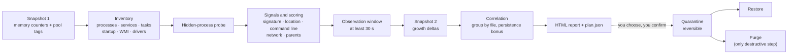

<div align="center">

# RAM Doctor

**Find out why your RAM is full when Task Manager shows nothing.**

Read-only triage for Windows 11 and 10: kernel pool leaks, unattributed memory,
hidden and suspicious processes, with a reversible clean-up.

[](https://github.com/iiKurro/ram-doctor/actions/workflows/ci.yml)
[](https://github.com/iiKurro/ram-doctor/releases/latest)
[](LICENSE)
[](#faq)
[](docs/architecture.md)
[](docs/privacy-and-safety.md)

[**Download**](https://github.com/iiKurro/ram-doctor/releases/latest/download/RAM-Doctor.bat) &nbsp;·&nbsp;
[Website](https://iikurro.github.io/ram-doctor/) &nbsp;·&nbsp;
[Documentation](docs/) &nbsp;·&nbsp;
[العربية](README.ar.md) &nbsp;·&nbsp;
[Report a false positive](https://github.com/iiKurro/ram-doctor/issues/new?template=false_positive.yml)

**English** · [العربية](README.ar.md)

<table>
  <tr>
    <td align="center"></td>
    <td align="center"></td>
  </tr>
</table>

</div>

## Why RAM Doctor exists

A PC with 16 GB of RAM "in use", an empty desktop, and a Task Manager whose
process list adds up to a fraction of that. It happens, and the usual causes
are invisible to Task Manager:

* **Kernel pool leaks.** A driver (network, GPU, storage, VPN, security
  software) allocates non-paged or paged pool memory and never frees it. That
  memory belongs to **no process**, so no process list shows it.
* **Memory outside every process.** Driver-locked pages, AWE, RAM disks,
  hardware-reserved regions.
* **Something hiding.** A miner or other malware that masquerades as a system
  process, runs from `Temp`, or hides from the process list.
* **A legitimate program that quietly grows**, or Fast Startup keeping a
  leaking kernel alive across "shut downs".

RAM Doctor reads the evidence for all of these in about a minute and tells you,
in plain language, which one you are looking at. It then lets you act on
suspicious files **safely and reversibly**.

It does not replace RAMMap, PoolMon or an antivirus; it connects the dots they
give you and points you to the next tool when needed.

<details>
<summary><b>More screenshots</b></summary>

<table>
  <tr>
    <td align="center"><br><sub>Scan in progress</sub></td>
    <td align="center"><br><sub>Kernel pool leak verdict</sub></td>
    <td align="center"><br><sub>Clean result</sub></td>
  </tr>
</table>

</details>

## Features

* **Memory x-ray**: private vs. shared working sets, non-paged and paged pool,
  modified and standby lists, and the *unaccounted remainder*, measured twice
  to show what is growing **right now**.
* **Kernel pool-tag table** (the data PoolMon shows) with a heuristic mapping of
  the biggest and fastest-growing tags to the driver files that contain them.
* **Hidden-process probe**: asks the kernel about every PID and compares with
  the normal lists; separates real hidden processes from harmless zombies.
* **Explainable suspect detection**: signature, location, name masquerading,
  command-line patterns, miner indicators, unusual parents, mining-port
  connections, growth. Every finding lists *why*, with a Low / Medium / High
  score ([details](docs/how-detection-works.md)).
* **Persistence inventory**: services (including `svchost` DLLs), scheduled
  tasks, Run keys of all users, startup folders, permanent WMI subscriptions,
  running drivers, Winlogon / IFEO / AppInit anomalies.
* **Reversible quarantine**: stop, disable, move aside; **Restore** brings
  everything back. Deleting for good (**Purge**) is a separate step.
* **Windows 11 style window** that follows your light/dark theme, plus an
  Arabic (RTL) HTML report.
* **One file, no install**: `RAM-Doctor.bat`, plain readable text. Nothing is
  left behind when you close it, apart from the small report you asked for.
* **Easy to hand to a helper**: open the report's folder, copy a redacted
  summary, or use the optional **Share** button.
* **Light on a struggling PC**: the scan peaks at roughly 110 MB of RAM (measured
  on a typical PC), runs at below-normal CPU, I/O and memory priority, and takes
  about a minute.
* **Privacy first**: the scan never uses the network and there is no telemetry.

## Quick start

1. **Download** [`RAM-Doctor.bat`](https://github.com/iiKurro/ram-doctor/releases/latest/download/RAM-Doctor.bat)
   from the [latest release](https://github.com/iiKurro/ram-doctor/releases/latest).
   Optionally verify it: `Get-FileHash .\RAM-Doctor.bat -Algorithm SHA256`
   against `SHA256SUMS.txt`.
2. **Double-click it.** If SmartScreen warns, click *More info* then *Run
   anyway* (the file is not code-signed; it is plain text you can read first).
   Approve the **UAC** prompt: administrator rights give full visibility.
3. Press **Start scan** and wait about a minute. Run it **while the problem is
   visible** (RAM full); a scan sees only the moment it runs.
4. **Read the result.** The headline tells you the likely cause; *Open the full
   report* explains the evidence.
5. *Only if the report shows suspicious files:* tick them and press
   **Quarantine**. Restart, then scan again to confirm the RAM is back.
6. *If someone is helping you*, send them the result: see
   [Sending your report](#sending-your-report-to-your-helper).

> Use **Restart**, not **Shut down**: with Fast Startup a shutdown does not
> reset a leaking kernel.

## How it works



The window only launches two scripts: the **scan** (never changes the system)
and the **actions** (the only code that does, and only on items you pick).
More in [docs/architecture.md](docs/architecture.md).

## What it checks

| Area | What is examined |
| --- | --- |
| Memory | Total / used / available, private and shared working sets, non-paged and paged pool, modified, standby, commit vs. limit, hardware-reserved, unaccounted remainder, growth during the window |
| Kernel pool | Pool-tag table, top non-paged / paged tags, fastest-growing tags, candidate drivers per tag |
| Processes | Path (even for protected processes), signature, location, command line, parent, start time, handles, growth, network connections |
| Hidden processes | Direct kernel PID probe vs. process lists; live vs. zombie |
| Persistence | Services, scheduled tasks, Run/RunOnce (all loaded user hives + machine), startup folders, WMI permanent consumers, Winlogon / IFEO / AppInit |
| Drivers | Running kernel drivers, third-party drivers sorted by age, signature |
| Evidence | Defender status and detections, Resource-Exhaustion events, Fast Startup + uptime |

## What it saves on your PC

| Where | What | When |
| --- | --- | --- |
| `C:\ProgramData\RAM-Doctor-run\<random>\` | Unpacked scripts of the one-file release (~330 KB), in a folder only Administrators and SYSTEM can write to | While the window is open; deleted on exit |
| `Desktop\RAM-Doctor-Reports\` | `RAMDoctor-<host>-<stamp>.html` and `Plan-<host>-<stamp>.json` (~45 KB per scan) | Every scan; the **newest 3** scans are kept |
| `C:\ProgramData\RAM-Doctor\` | Quarantined files, `manifest.json`, `actions-<stamp>.log` | Only if you use quarantine |
| System restore point | "RAM-Doctor before quarantine" | Before a quarantine, if System Protection is on |
| `%APPDATA%\RAM-Doctor\profile.json` | Display name, random id, optionally a DPAPI-protected code (< 1 KB) | **Only if you use the Share button**; the app can delete it |

No registry changes, services, scheduled tasks or startup entries. The scan
makes **no network connection**. Details: [docs/privacy-and-safety.md](docs/privacy-and-safety.md).

## Sending your report to your helper

If a friend or technician is helping you, you have three options, from most
manual to most convenient. **Do not post reports in public issues.**

| Option | What it does |
| --- | --- |
| **Report location** (مكان ملف التقرير) | Opens Explorer with the report selected, ready to attach to an e-mail or chat. The file is *not* redacted: send it only to someone you trust. |
| **Copy summary for sending** (نسخ ملخص للإرسال) | Copies a short **redacted** plain-text summary to paste into a chat. Read it before sending. |
| **Share with my helper** (optional) | One click: uploads a **redacted** bundle to your helper's **private** repository. |

**The scan never uses the network and there is no telemetry. The only network
feature is the Share button, which does nothing until you press it and
confirm; it uploads a redacted bundle (`summary.md`, `report.html`,
`plan.json`) to the helper's *private* repository.** The first time you use it
you pick a permanent username (no invite code needed). The Windows user name,
PC name (unless you tick the box), e-mail addresses and secrets in command
lines are removed. The button is hidden in builds where no relay endpoint is
configured. The program holds no token: a small relay (Cloudflare Worker, in
[`server/`](server/README.md)) does the upload, with rate limits, a three-file
whitelist, a 2 MB cap, sanitised inert reports, no read route and a kill
switch. How it works, and how helpers deploy their own:
[docs/sharing.md](docs/sharing.md) · privacy view:
[docs/privacy-and-safety.md](docs/privacy-and-safety.md#the-optional-share-button).

<table>
  <tr>
    <td align="center"><br><sub>Share with my helper</sub></td>
    <td align="center"><br><sub>Your profile, with a delete button</sub></td>
  </tr>
</table>

## Safety model

* **The scan is read-only.** It cannot change your system.
* **Changes are explicit.** Quarantine acts only on items you tick and confirm.
* **Reversible by default.** Files are moved to a quarantine folder (renamed
  `.quar`), services/tasks are only *disabled*, startup values are backed up.
  **Restore** undoes it. **Purge** is the only destructive step and asks
  separately.
* **Windows is never touched.** Anything under `%WINDIR%`, and anything with a
  valid Microsoft signature, is refused. Boot/system-start drivers are refused.
* **Re-validated at the last moment.** Host check, SHA-256 re-check, PID +
  start-time check before a process is stopped.
* **Safety net.** A System Restore point is requested first.
* **Honest limits.** The plan file is a trusted local input; RAM Doctor is not
  an antivirus. See [docs/privacy-and-safety.md](docs/privacy-and-safety.md#known-limitations).

## Interpreting results

| Headline | What it means | What to do |
| --- | --- | --- |
| *A driver leak on the kernel level is the likely cause* | Non-paged or paged pool is far above normal (for example several GB). No process owns it. | Open the report, look at the **pool-tag table** and the candidate driver, update or remove that driver (or the app that installs it), restart, scan again. |
| *A large part of memory is not attributed to any process* | Memory sits outside every working set: driver-locked, AWE, RAM disk, hidden process. | Use RAMMap's *Use Counts* tab to see the category; check the hidden-process section. |
| *Indicators that deserve urgent review (may be malware)* | One or more **High** suspects, or a live hidden process. | Check the SHA-256 on VirusTotal, run an offline scan (Defender Offline), then quarantine if confirmed. |
| *Notes of medium severity* | Something unusual but not conclusive (near commit limit, Fast Startup, a growing program). | Read the notes; usually a restart or an update. |
| *No clear leak or malicious indicator right now* | Nothing crossed a threshold at this moment. | Scan again **while RAM is full**. |

**Risk levels** come from a score: High >= 8, Medium 5-7, Low 3-4 (Low items
are listed in the report but not offered for quarantine). They are
**indicators, not verdicts**: an unsigned hobby tool in `AppData` is Low by
design. See [docs/how-detection-works.md](docs/how-detection-works.md).

## Command line (advanced)

```powershell
# scan only; writes the report and plan to Desktop\RAM-Doctor-Reports
powershell -NoProfile -ExecutionPolicy Bypass -File src\RAM-Doctor.ps1 -NoOpen

# actions on the latest plan (elevated)
powershell -NoProfile -ExecutionPolicy Bypass -File src\RAM-Doctor-Actions.ps1 -Mode Quarantine -Select "1,3"
powershell -NoProfile -ExecutionPolicy Bypass -File src\RAM-Doctor-Actions.ps1 -Mode Restore
powershell -NoProfile -ExecutionPolicy Bypass -File src\RAM-Doctor-Actions.ps1 -Mode List
```

| Script | Parameters |
| --- | --- |
| `RAM-Doctor.ps1` | `-SampleSeconds 30` observation window · `-OutDir` · `-NoOpen` · `-KeepRawJson` · `-ThresholdScale 1.0` (below 1 is more sensitive) |
| `RAM-Doctor-Actions.ps1` | `-Mode Quarantine\|Restore\|Purge\|List` · `-Plan` · `-Select "1,3"` · `-IncludeLow` · `-Yes` · `-NoRestorePoint` · `-Batch` · `-OlderThanDays` · `-StoreDir` |

## FAQ

<details>
<summary><b>Does it upload my data?</b></summary>

**The scan never uses the network and there is no telemetry.** The only network
feature is the optional **Share with my helper** button. It does nothing until
you press it and confirm, and then uploads a redacted bundle (`summary.md`,
`report.html`, `plan.json`) to your helper's private repository through a
relay; the program itself holds no token. The button is hidden in builds without
a configured relay, and you can always send the report by hand instead. See
[docs/privacy-and-safety.md](docs/privacy-and-safety.md).
</details>

<details>
<summary><b>My antivirus flags it. Is it malware?</b></summary>

It is an unsigned PowerShell/batch tool that enumerates processes, reads kernel
statistics, and can stop processes and move files; some products flag that
behaviour. The release is plain text with no obfuscation, no base64, no
`Invoke-Expression` and no hidden window, so you can read exactly what it does.
Verify the SHA-256 against `SHA256SUMS.txt`, and report the false positive to
your vendor. See [docs/troubleshooting.md](docs/troubleshooting.md#antivirus-flags-or-deletes-ram-doctorbat).
</details>

<details>
<summary><b>Why is it not signed?</b></summary>

Code-signing certificates cost money and this is a free project by a single
developer.
Signing is on the roadmap; until then, verify the checksum.
</details>

<details>
<summary><b>Why does it need administrator rights?</b></summary>

For full visibility (paths of protected processes, other users' startup
entries) and for the actions (disabling services, creating a restore point,
writing the quarantine store). The scan alone still works without them, with
reduced coverage.
</details>

<details>
<summary><b>Does it replace an antivirus?</b></summary>

No. It explains memory problems and flags suspicious items by heuristics. Use
it next to your antivirus, and use an offline scanner if it reports a live
hidden process.
</details>

<details>
<summary><b>A safe program is rated suspicious. What now?</b></summary>

Scores are heuristic indicators. Open a
[false-positive report](https://github.com/iiKurro/ram-doctor/issues/new?template=false_positive.yml)
with the redacted details; tuning the weights from real reports is the most
valuable contribution.
</details>

<details>
<summary><b>Will it find every cause?</b></summary>

No. See [what is not detected](docs/how-detection-works.md#what-is-not-detected):
single-snapshot limits, kernel-level rootkits, signed malware, injected code,
and exact pool-tag attribution are the main gaps.
</details>

<details>
<summary><b>Which Windows versions are supported?</b></summary>

Developed and tested on Windows 11. Windows 10 22H2 is expected to work but is
less tested; Windows 11-only visual effects simply do not appear there. It needs
Windows PowerShell 5.1, which ships with both. The window and the report are
currently **Arabic (RTL)**; an English interface is on the roadmap.
</details>

<details>
<summary><b>Does it work offline?</b></summary>

Yes. The scan, the report and the actions need no internet. Only the optional
Share button does.
</details>

## Build from source

```powershell
git clone https://github.com/iiKurro/ram-doctor.git
cd ram-doctor
powershell -NoProfile -File build\Build-SingleFile.ps1     # -> dist\RAM-Doctor.bat
```

Run directly from source (elevated prompt):
`powershell -NoProfile -ExecutionPolicy Bypass -STA -File src\RAM-Doctor-GUI.ps1`.
How the one-file release is built, and why it is plain text:
[docs/architecture.md](docs/architecture.md#single-file-packer).

## Project structure

```
ram-doctor/
├─ src/
│  ├─ RAM-Doctor-GUI.ps1        Windows 11 style window (launches the two scripts below)
│  ├─ RAM-Doctor.ps1            read-only scan -> report + plan.json
│  ├─ RAM-Doctor-Actions.ps1    quarantine / restore / purge / list
│  └─ lib/
│     ├─ Native.cs              read-only P/Invoke helpers (pool tags, PID probe, ...)
│     ├─ Fluent.cs              Windows 11 style WinForms controls
│     └─ Report.ps1             HTML report builder
├─ server/                      relay (Cloudflare Worker) behind the Share button
├─ build/Build-SingleFile.ps1   packs src/ into dist/RAM-Doctor.bat
├─ tests/                       automated checks (run by CI)
├─ docs/                        documentation and the project website
└─ .github/                     CI, release workflow, issue forms
```

## Roadmap

Ideas, not promises:

* English interface and report (the UI is Arabic-first today).
* Code signing of releases; a `winget` package.
* A RAMMap-style memory-type breakdown (driver-locked, AWE, mapped file).
* ETW-based pool allocation tracing to name the call stack of a leak.
* More persistence locations (Active Setup, BHOs, print monitors, LSA
  providers) and module/injection inspection.
* Offline / WinPE mode.
* Versioned, documented JSON schemas for the plan and report.

## Contributing

Bug reports and **false-positive reports** are welcome. Code contributions are
not accepted: the project is all rights reserved. Read
[CONTRIBUTING.md](CONTRIBUTING.md) and the [Code of Conduct](CODE_OF_CONDUCT.md).
Found a security problem? Use the private channel in [SECURITY.md](SECURITY.md).

## License

© 2026 7san. **All rights reserved.** RAM Doctor is free to use on your own PCs
and to help friends and family without payment; the code is visible so you can
review what it does. You may not copy, modify, sell or republish it, and the
name and logo are covered by [TRADEMARKS.md](TRADEMARKS.md). Read the full
[LICENSE](LICENSE).

Versions 1.0.0 and 1.0.1 were published under the MIT License and stay
available under it ([text](LICENSE-MIT-v1.0.x.txt)).

## Acknowledgements

* The project website's design takes inspiration from community components on
  [21st.dev](https://21st.dev): `scrollxui/download-with-columnlines`,
  `bidyut10/download-button` and `ln-dev7/how-it-works-09`.
* Prior art this tool builds on and complements: Sysinternals
  [RAMMap](https://learn.microsoft.com/sysinternals/downloads/rammap) and
  PoolMon.
* [Contributor Covenant](https://www.contributor-covenant.org/),
  [Shields.io](https://shields.io/), [Mermaid](https://mermaid.js.org/).
