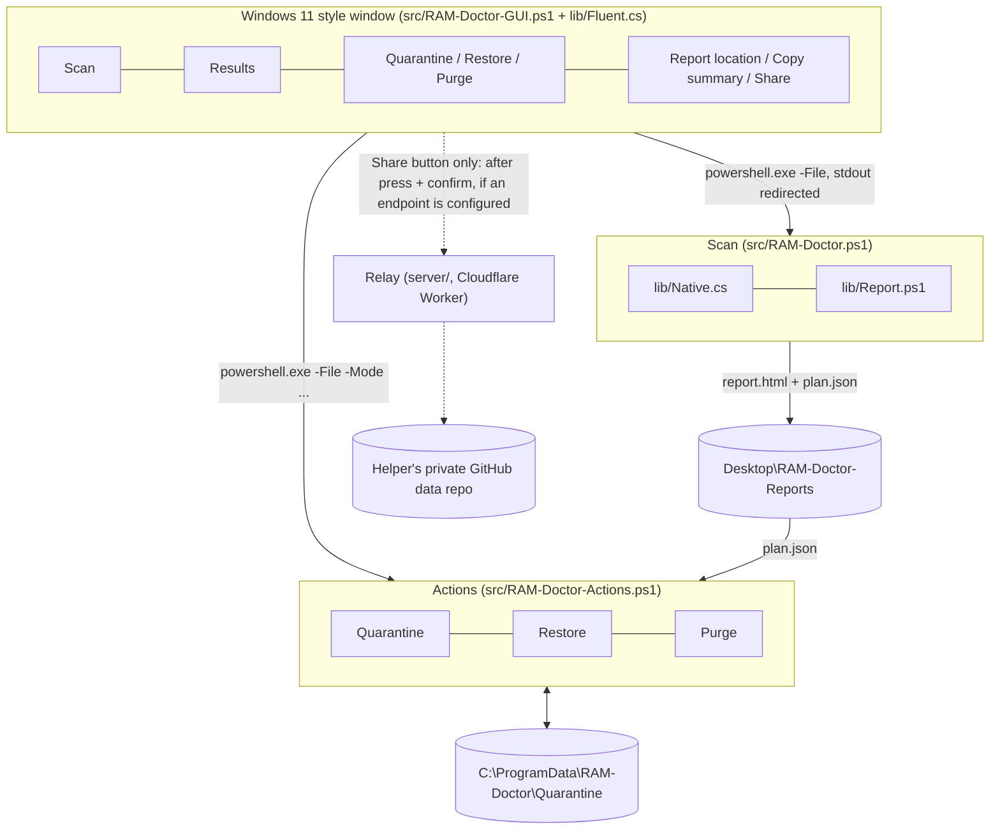

# Architecture

This document describes how RAM Doctor is put together: components, data flow,
file formats, and the single-file packer. For *why* a file is rated the way it
is, read [how-detection-works.md](how-detection-works.md). For what the tool
stores, reads and sends, read [privacy-and-safety.md](privacy-and-safety.md).

## Design goals

1. **Read-only by default.** Scanning never changes the machine.
2. **Every change is explicit, validated and reversible.** One script is
   allowed to change the system, and it undoes everything except `Purge`.
3. **Inspectable.** Plain PowerShell and a small C# helper; the release is a
   readable text file.
4. **Light.** No install, no background service, a few small files.
5. **The scan never uses the network; no telemetry; no secrets in the
   program.** The only network feature is the optional *Share with my helper*
   button, which does nothing until the user presses it and confirms and goes
   through a relay that holds the credential. Sending the report by hand
   (file or copied redacted summary) always works.

## Overview



## Components

| File | Role |
| --- | --- |
| `src/RAM-Doctor-GUI.ps1` | The window. It contains **no scanning logic**: it starts the scan and the actions as child `powershell.exe` processes, parses their timestamped progress lines for the progress bar, and reads the plan file to show results. It also provides the *report location* and *copy summary for sending* buttons and the optional *Share with my helper* flow (hidden when `share.config.json` has no endpoint). |
| `src/lib/Fluent.cs` | Windows 11 style WinForms controls (cards, buttons, list, progress, info bar) compiled with `Add-Type`. They draw correctly both right-to-left (Arabic) and left-to-right (English): every control reads its own `RightToLeft` when it paints. |
| `src/lib/Strings.ps1` | The one string table: an `ar` and an `en` table with the same keys, and `Get-Text` / `Set-UiLang` / `Get-UiLang`. No other source file holds a user-facing literal (checked by `tests/Strings.Tests.ps1`). |
| `src/RAM-Doctor.ps1` | The scan. Collects evidence, scores it, writes the report and the plan. Never modifies the system. |
| `src/RAM-Doctor-Actions.ps1` | `Quarantine`, `Restore`, `Purge`, `List`. The only code that changes the system. |
| `src/lib/Native.cs` | Read-only P/Invoke helpers (see below), compiled with `Add-Type` (C# 5). |
| `src/lib/Report.ps1` | Builds the HTML report from the scan's data object. Self-contained (inline CSS, no scripts, no network). |
| `src/lib/Store.ps1` | Crash-safe JSON files and an inter-process lock: `Write-JsonAtomic` (write `<file>.tmp`, flush, one rename that keeps the previous version as `<file>.bak`, adds a `schema` field), `Read-JsonSafe` (falls back to `.bak`, never throws, keeps a damaged file as `<file>.damaged-<stamp>`, reads 1.0.x files without `schema` as schema 1, refuses files from a newer schema) and `Use-StoreLock` (named mutex, `Busy` on timeout). |
| `build/Build-SingleFile.ps1` | Packs `src/` into the one-file `dist/RAM-Doctor.bat`. |
| `server/` | The relay (Cloudflare Worker) behind the optional *Share with my helper* button. Deployed and operated by the maintainer/helper. See [server/README.md](../server/README.md). |

### `Native.cs`

| Method | Purpose |
| --- | --- |
| `GetPoolTags()` | `NtQuerySystemInformation(SystemPoolTagInformation = 22)`: the same table PoolMon shows. Entry layout is handled for x64 and x86. |
| `ProbePids(max)` | Walks PIDs `4..max` (multiples of 4), `OpenProcess(PROCESS_QUERY_LIMITED_INFORMATION)`. Returns `pid:A` (opened, still running) or `pid:D` (access denied). |
| `GetImageName(pid)` | `NtQuerySystemInformation(SystemProcessIdInformation = 88)`: image path **without opening a handle**; works for protected and zombie processes. |
| `NtToDosPath(path)` | `\Device\HarddiskVolumeN\...` to `C:\...` via `QueryDosDevice`. |
| `FindTagsInFiles(files, tags)` | Scans driver binaries for 4-byte pool tags (single pass per file with a first-byte filter). |

## Scan pipeline

`RAM-Doctor.ps1` runs these stages in order (the GUI maps the printed
`[hh:mm:ss] ...` lines to its progress bar):

1. **Snapshot 1**: memory counters (WMI `Win32_PerfFormattedData_PerfOS_Memory`,
   locale independent), per-process performance rows, kernel pool tags.
2. **System facts**: OS, CPU/GPU, installed vs. usable RAM, uptime, Fast
   Startup flag.
3. **Inventory** into one list of items, each with `Kind`, `Name`, `Path`,
   `Cmd`: processes, services (skipping `Disabled`, resolving `svchost`
   `ServiceDll`), scheduled tasks (skipping disabled tasks and benign
   `\Microsoft\Windows\` tasks under `%WINDIR%`), Run/RunOnce for every loaded
   user hive plus HKLM, startup folders (`.lnk` targets resolved), permanent
   WMI event consumers, running kernel drivers; plus established TCP
   connections to public addresses.
4. **Hidden-process check** (kernel PID probe vs. process lists).
5. **Rating**: every item gets a list of *signals* (key, points, reason text).
   The tool's own process chain is excluded.
6. **Observation window**: waits until at least `-SampleSeconds` (default 30)
   have passed since snapshot 1.
7. **Snapshot 2**: growth deltas per process, for non-paged/paged pool, commit
   and used memory, and per pool tag.
8. **Correlation**: items are grouped by file path into *suspects*, signals are
   merged, a persistence bonus is applied, risk is derived from the score.
   Windows/Microsoft-signed binaries are judged per item instead of per file.
9. **Memory accounting and pool-tag mapping** (top tags to driver files).
10. **Evidence**: Defender status and detections, Resource-Exhaustion events,
    Winlogon / IFEO / AppInit anomalies.
11. **Observations and verdict**: rule-based, text in the scan language (Arabic or English, see [Language](#language)).
12. **Output**: report HTML, plan JSON, pruning of old scans.

## Output files

Default folder: `Desktop\RAM-Doctor-Reports` (override with `-OutDir`).

| File | Content |
| --- | --- |
| `RAMDoctor-<HOST>-<yyyyMMdd-HHmmss>.html` | The report (Arabic RTL or English LTR, light and dark). About 30 KB. |
| `Plan-<HOST>-<yyyyMMdd-HHmmss>.json` | The plan: verdict, observations, memory summary, suspects with everything needed to act on them. About 15 KB. |
| `RAMDoctor-<HOST>-<stamp>.json` | Full raw data. **Only** with `-KeepRawJson`. |

Every file is written crash-safe (`<file>.tmp`, flushed, then renamed into
place by `lib/Store.ps1`), so a power cut never leaves a half-written plan. The
newest **3** scans of this PC are kept (the scan just written always counts as
one of them, even when the clock runs behind); files of other PC names are never
touched. The last console line
`SCAN_STAMP: <yyyyMMdd-HHmmss>` tells the window which plan is new; it builds
the file names from its own PC name, so no path has to survive the console code
page.

## Plan JSON (schema v1, informal)

The plan is the contract between the scan and the actions (and the GUI). It is
also what the optional upload bundle and the copied summary are derived from
(after redaction).

```jsonc
{
  "schema": 1,                                   // written since 1.1; a plan without it is schema 1 too. A newer schema is refused.
  "tool": "RAM-Doctor", "version": "1.0", "lang": "en", "host": "DESKTOP-DEMO",   // "lang" ar|en: language of every text below; absent in plans of older releases (= ar)
  "created": "2026-10-24 21:52:51", "isAdmin": true,
  "report": "C:\\Users\\Friend\\Desktop\\RAM-Doctor-Reports\\RAMDoctor-DESKTOP-DEMO-20261024-215251.html",
  "verdict": { "Level": "high|med|low|ok", "Headline": "..." },
  "observations": [ { "Level": "high|med|low|info", "Title": "...", "Body": "..." } ],
  "memory": { "TotalGB": 31.83, "UsedGB": 26.7, "NonPagedGB": 0.77, "PagedGB": 0.84,
              "UnaccountedGB": 0, "StandbyGB": 5.0, "CommittedGB": 43, "CommitLimitGB": 48.8,
              "WindowSec": 37, "NonPagedGrowthMB": 0, "PagedGrowthMB": 0 /* ... */ },
  "suspects": [
    {
      "id": 1, "risk": "High|Medium|Low", "score": 10,
      "name": "svch0st.exe", "path": "C:\\Users\\Friend\\AppData\\Local\\Temp\\svch0st.exe",
      "fileExists": true, "protectedFile": false,
      "sha256": "…", "sizeBytes": 4096, "created": "2026-10-24 21:00:00",
      "trust": "Unsigned", "sigStatus": "NotSigned", "publisher": "",
      "company": "", "description": "",
      "reasons": [ "…human readable, one per signal…" ],
      "procs":    [ { "pid": 1234, "start": "…", "cmd": "…", "privMB": 903, "growthMB": 558, "remote": ["203.0.113.5:3333"] } ],
      "services": [ { "name": "…", "display": "…", "startMode": "Auto", "state": "Stopped" } ],
      "tasks":    [ { "taskPath": "\\", "taskName": "…", "state": "Ready", "cmd": "…" } ],
      "autoruns": [ { "via": "Registry|StartupFolder", "location": "…", "name": "…", "value": "…", "file": "" } ],
      "drivers":  [ { "name": "…", "display": "…", "startMode": "Manual" } ],
      "wmi":      [ { "class": "CommandLineEventConsumer", "name": "…", "cmd": "…" } ]
    }
  ]
}
```

Notes:

* `protectedFile` is `true` when the file is Windows/Microsoft-signed. Such a
  suspect is really *a command line*, so the actions never move the file; they
  can only stop the process or remove the entry that launches it.
* The plan contains full paths and command lines. It is **not redacted** on
  disk; see [privacy-and-safety.md](privacy-and-safety.md).
* `Select` ids refer to `suspects[].id`.

## Actions

```
RAM-Doctor-Actions.ps1 -Mode Quarantine|Restore|Purge|List
    [-Plan <file>] [-Select "1,3"] [-IncludeLow] [-Yes] [-NoRestorePoint]
    [-Batch <name>] [-OlderThanDays <n>] [-StoreDir <dir>] [-AllowNonAdmin]
```

`-Select` is a **string** on purpose: a typed `[int[]]` parameter turns
`-File x -Select 1,2` into `12`.

**Quarantine** flow: load the plan, refuse if `host` differs, warn if older than
24 h, list High/Medium (and Low with `-IncludeLow`), take the selection, require
the typed `YES` (or `-Yes`), create a restore point, then per suspect:

1. Re-hash the file; skip the suspect if it differs from the plan.
2. Refuse to move files under `%WINDIR%`, Defender folders, Microsoft
   `WindowsApps` packages, the tool's own folder and the store; refuse
   Microsoft-signed files.
3. Stop processes (PID **and** start time within 3 s, to defeat PID reuse;
   plus same-path respawns).
4. Disable services (`sc.exe config ... start= disabled`, previous
   `Start`/`DelayedAutostart` recorded). Drivers only if third-party and not
   boot/system start.
5. Disable scheduled tasks; remove Run values (value compared with the plan and
   saved); move startup shortcuts; remove WMI consumers (definition saved).
6. Move the file to `<store>\Quarantine\<batch>\files\NNN_<name>.quar` (names
   are kept short and never reused).
7. The undo record `manifest.json` is written **before** the first change and
   then around every step ("write-ahead"): each change is first recorded as
   `pending` with everything needed to undo it, then marked `done` or
   `failed`. It is replaced atomically (`manifest.json.tmp` + rename, previous
   version kept as `manifest.json.bak`). If it cannot be saved, the run stops
   before changing anything else.

**Restore** reverses the manifest in reverse order. Each item that is back gets
`undoneAt`; an item that is refused or whose quarantined copy is missing counts
as a failure. Before a file is moved back, its target is recorded (`restoringTo`),
so a restore interrupted after the move is recognised and finished by the next
run. Only when nothing failed is the batch stamped `restoredAt` (if that last save
fails: `UNSAVED`, exit 3, safe to run again); otherwise the run says
`Restore INCOMPLETE`, exits with 2 and a later run only retries what is not back
yet. A `pending` step (a crash) is undone if it
happened. **Purge** deletes the `files` folders (typed `DELETE` or `-Yes`) and
stamps `purgedAt`. A batch whose record is damaged (and its `.bak` too) or was
never written is listed as `damaged` / `orphan`: it cannot be restored, but its
files can be purged. A record that exists but cannot be opened right now (held by
another program) is `unreadable`: refused for now, never replaced by its older
`.bak` and never overwritten. Quarantine, Restore and Purge hold a per-store lock; a
second run answers `BUSY` (exit 4) and changes nothing. The lock's name comes
from a random secret in `<store>\lock.id` that only SYSTEM and Administrators can
read, and the secret is replaced before every release, so a non-elevated program
cannot predict or squat the name. When elevated, batch folders, their `files`
folder and every `manifest.json.tmp` are **created** with owner Administrators and
SYSTEM + Administrators only (never protected afterwards), and a batch is trusted
only if its folders and records have such an owner and no allow-rule, explicit or
inherited, for anybody else (1.0.x batches, which inherit the store's permissions,
pass). Actions log to
`<store>\actions-<stamp>.log` (the newest 30 are kept).

Every run ends with a machine-readable line for the window:
`RESULT: OK [...]`, `PARTIAL <n>` (exit 2), `UNSAVED` (exit 3),
`FAILED <reason>` (exit 1; `nosave` = the undo record could not be saved,
`error` = an unexpected error, `unreadable`, `damaged`, ...), `BUSY` (exit 4) or
`NONE`. `-Mode List` prints one
`BATCH_JSON: {"name","state","items","files","bytes","seq","created"}` line per
batch (state `restorable|restored|purged|damaged|orphan|toonew|unreadable`), newest first;
the window reads only these lines, never the manifests themselves.

### Quarantine manifest

```jsonc
{ "schema": 1,                                      // since 1.1; 1.0.x manifests have none and are schema 1
  "batch": "20261024-215344", "created": "…", "host": "DESKTOP-DEMO", "plan": "…",
  "seq": 3,                                         // since 1.1: "newest batch" without trusting the clock (absent = 0)
  "restoredAt": "…", "purgedAt": "…",              // present only when it happened
  "entries": [ { "id": 1, "name": "…", "risk": "High", "path": "…", "sha256": "…",
                 "ops": [ { "type": "StopProcess|DisableService|DisableDriver|DisableTask|RemoveRunValue|MoveStartupFile|RemoveWmi|QuarantineFile",
                            "status": "pending|done|failed",   // pending: written before the step, the run stopped around it
                            "undoneAt": "…",                   // since 1.1: put back by a (partial) restore
                            "restoringTo": "…", "restoringSha256": "…",   // since 1.1: written just before a file is moved back
                            /* plus type-specific undo data */ } ] } ] }
```

The format stays readable by 1.0.x (which ignores the new fields and skips
`pending` steps); an unknown operation type is never counted as restored.

WMI removals store the full definition but cannot be restored automatically.

## Sending a report

**Always available (manual, no network).** The report and plan are ordinary
local files. The GUI offers two buttons:

* *Report location* (Arabic: مكان ملف التقرير) opens Explorer with the
  report selected, so it can be attached to an e-mail or chat.
* *Copy summary to send* (Arabic: نسخ ملخص للإرسال) puts a short **redacted**
  plain-text summary on the clipboard, to paste into a chat. Its labels are in the
  window language.

## Optional: one-click Share with my helper

The **only** code path that uses the network. It does nothing until the user
presses *Share with my helper* and confirms, and it is **hidden in builds where
the endpoint in `share.config.json` is empty** (the maintainer fills it in
before a release once a relay is deployed).

* **Profile**: on first use the user picks a permanent display name; no invite
  code is needed from users. `%APPDATA%\RAM-Doctor\profile.json` holds the
  display name, a random 8-hex id and, only if a code was ever required, that
  code protected with Windows DPAPI (bound to the Windows account). It exists
  only if Share is used, and the GUI has a *delete my profile* button.
* **Bundle**: `summary.md`, `report.html`, `plan.json`, produced from the scan
  output with a redaction pass (Windows user name, PC name unless the checkbox
  includes it, e-mail addresses, secrets in command lines).
* **Transport (protocol v1)**: HTTPS `POST /v1/reports` with a JSON body to the
  relay. The relay accepts **exactly three files** (whitelist) and at most
  **2 MB** per request, and commits them to the helper's **private** GitHub
  data repository under `reports/<name>-<id>/<timestamp>/`.
* **Relay protections (open mode)**: rate limits, reports are sanitised so
  that only inert content is stored, there is no route to read stored
  reports, the maintainer has a kill switch, and invite codes can optionally be
  required. Details: [sharing.md](sharing.md) and
  [server/README.md](../server/README.md); they are not duplicated here.
* **No secret in the program.** The relay holds the only credential.

The privacy view is in
[privacy-and-safety.md](privacy-and-safety.md#the-optional-share-button).

## Single-file packer

`build/Build-SingleFile.ps1` produces `dist/RAM-Doctor.bat`:

```
@echo off  ... header (cmd) ...
#@@FILE src\RAM-Doctor-GUI.ps1
<script text>
#@@FILE src\RAM-Doctor.ps1
<script text>
...
```

When double-clicked the header:

1. relaunches itself minimised (`start /min`), then requests administrator
   rights (`Start-Process -Verb RunAs`) if needed;
2. creates `%ProgramData%\RAM-Doctor-run\<guid>` atomically with an ACL that only SYSTEM and Administrators can use (inheritance off, by SID), and refuses to run anything from it unless the parent and child are not junctions, have a trusted owner and carry no other allow-rules (this closes a time-of-check/time-of-use hole: the scripts then run elevated, so a same-user process must not be able to edit them); folders older than a day are swept, except one whose `in-use.lock` is still held open by the copy that is running from it;
3. runs a short PowerShell one-liner that reads the `.bat` itself and writes
   each `#@@FILE` section to that folder with a UTF-8 BOM (the BOM is stripped
   in the repository build step and restored here);
4. holds `in-use.lock` open in that folder, runs `src\RAM-Doctor-GUI.ps1`, waits, and always deletes the folder afterwards.

`cmd.exe` never parses past `exit /b`, so the payload is inert text to it.

### Why plain text and not base64

An opaque base64 blob that a hidden PowerShell decodes and executes is exactly
the shape of a malware dropper, and antivirus engines flag it. The release is
therefore:

* **plain text**, readable in Notepad: the code the user runs is the code in
  the file;
* no `Invoke-Expression`, no `-EncodedCommand`, no hidden window (only a
  *minimised* console), no download;
* with a header that says what it does.

The cost is a larger file (about 340 KB); the benefit is that it can be audited
and diffed, and it triggers fewer heuristics.

The release file has **no environment-controlled behaviour**: a check in
`build\Build-SingleFile.ps1 -Verify` and in CI fails if it mentions `RAMDOC_*`,
`-TestScript` or reads environment values other than the one it sets itself.
Tests use a separate variant, `dist\RAM-Doctor.devhooks.bat`
(`Build-SingleFile.ps1 -DevHooks`, banner "TEST BUILD - not for distribution",
never uploaded by the release workflow), which honours `RAMDOC_NOELEVATE` and
`RAMDOC_GUI_ARGS`.

## Conventions that matter

* **Windows PowerShell 5.1** and C# 5 (`Add-Type`).
* Every `.ps1` is **UTF-8 with BOM**; `.bat` is ASCII + CRLF.
* Console/log output is English ASCII; translated text is for the GUI, the report, the share messages and the copy-summary text.
* Known 5.1 traps handled in the code: `.Count` on a single `PSCustomObject`,
  `$null | ForEach-Object` running once, `[math]::Max(0, big)`, case-insensitive
  variable/parameter names, `-File` + `[int[]]`.

## Language

Arabic (right-to-left) and English (left-to-right) are both first-class. Every
sentence lives in `src/lib/Strings.ps1`; code calls `Get-Text 'key' args`.

* **Choosing**: `-Lang ar|en` on `RAM-Doctor-GUI.ps1`, `RAM-Doctor.ps1` and
  `RAM-Doctor-Share.ps1`; otherwise Arabic when the Windows UI language is Arabic
  (`(Get-UICulture).TwoLetterISOLanguageName -eq 'ar'`) and English for anything
  else. The window has a language button that switches the open window live
  (`RightToLeft` + `RightToLeftLayout` of the form, every text re-applied, the
  selection kept). Nothing is persisted: no profile entry, no settings file.
* **The scan** writes its observations, verdict headline, suspect reasons and
  the report in one language and records it as `lang` in the plan (the only
  schema change: an added optional field; readers treat a missing one as Arabic).
  The window starts the scan with its current language. A plan opened after a
  language switch keeps the language it was written in; the window says so and
  suggests a new scan.
* **The report** (`lib/Report.ps1`) reads `$data.Lang`: `<html lang dir>`, the
  texts, and the three labels of its one inline script. It keeps the inert-report
  contract (marker right after the doctype, one tiny script, no inline handlers,
  no external URLs except VirusTotal/GitHub links) in both languages;
  `tests/fixtures/Test-ReportSafety.ps1` and `tests/Contract.Tests.ps1` (the
  relay's validator) cover English and Arabic.
* **Share**: the messages shown in the window (`RESULT: ERROR <code> <text>`) and the
  labels of the chat summary follow `-Lang`; the upload bundle's `summary.md` stays
  English-labelled, and wraps the (Arabic) scan sentences in a right-to-left block
  only for Arabic plans (the relay keeps exactly `<div dir="rtl">`).
* **Console and logs** are English ASCII in both languages.

## Extending

* **New text or language**: add the key to both tables of `lib/Strings.ps1`
  (`tests/Strings.Tests.ps1` enforces the rest); a third language is a third table
  plus `Resolve-UiLang`.
* **New signal**: add a `& $add 'key' <points> (Get-Text 'sig.<name>')` line in
  `Get-Signals` (or a process-specific one in the rating loop), document it in
  [how-detection-works.md](how-detection-works.md), add a test.
* **New autostart location**: add it to the inventory section as `Add-Item`
  with `Kind = 'Autorun'` and teach `RAM-Doctor-Actions.ps1` how to disable and
  restore it.
* **Pool-tag description**: add a `tag.<name>` text to `lib/Strings.ps1` and map the tag to it in `$KnownTagKeys`.
